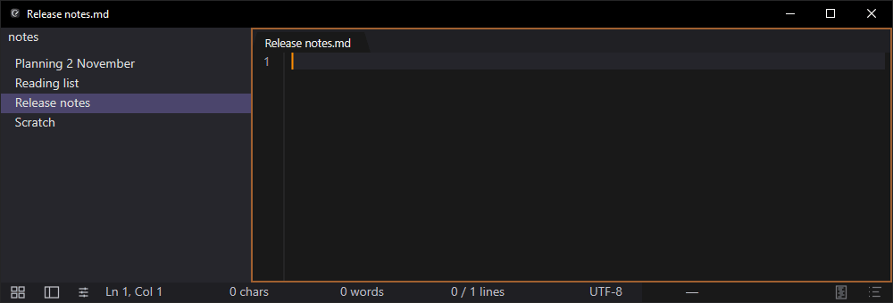

What I actually wanted was Sublime's speed with Obsidian's Markdown, and nobody was going to build it for me. This covers 9 to 31 May, first commit to v0.1.0, 101 commits.

I've used Sublime Text for years for the same reason everyone else does. It opens instantly, it never loses anything, and you can throw a scratch buffer at it without ceremony. No project, no file, no save, just type. Close it, reopen it, everything's still there.

What it doesn't do is Markdown. Not really. You get syntax colors on your asterisks, which is not the same thing as your notes looking like notes.

Obsidian does that part well. It also wants to be a knowledge graph with a plugin ecosystem and a startup time, and when I open a notes app I want the note, not a workspace.

So: Sublime's speed, ephemerality, and crash-safety, with Obsidian's live Markdown. That's the whole brief. Three weeks later there was a binary.

## Day one got further than it should have

Twelve commits on 9 May, and by the end of them the thing already had a rope, persistence, keymap-driven command dispatch, a selection model, rich editing commands, an undo system, find and a command palette, a layout cache with soft-wrap, and live Markdown preview.

That's not a brag about velocity, it's a statement about how much of an editor is well-trodden ground. Ropes are solved. Undo trees are solved. The parts that took the remaining three weeks were the parts nobody writes down.

The live Markdown part, which is the reason the project exists at all, looked like this once it settled:

Each line renders as it's completed, and the line under the caret shows its source instead. No preview pane, no mode switch.

The commit shape over those 23 days is two heavy bursts and then a long grind. The 12 May spike is CI, conventions, and perf gates landing at once. The 24 May spike is resize tearing, tab dragging, and search.

## The decision everything else hangs off

Sublime's crash-safety is the feature I actually wanted, and it's the one you can't bolt on later. So it went in on day one, before there was a UI worth crashing.

Every keystroke writes to a local SQLite database. The database is the document. A `.md` file is an export.

That sounds like a storage detail and it isn't. It decides what a tab is, what closing a window means, what "unsaved" means, whether there's a dirty indicator, whether closing prompts you. Answering it first meant saving to a file never had to be what keeps your work safe. Ctrl+S still writes the file and a tab still shows when its file is behind, but closing it or crashing loses nothing.

The corresponding rule on the rendering side landed with Markdown preview on day one: the text is the source of truth, and the rendering only shows it. The rendering layer can hide, replace, or wrap parts of the source. It cannot add content. Every WYSIWYG feature has to survive that layer being ripped out.

That killed several things I wanted over the following weeks, which is the point of having it.

## The middle two weeks were performance

WYSIWYG costs you. Every keystroke potentially reflows a projection, re-parses a Markdown subtree, and repaints. Sublime feels the way it does because it isn't doing any of that.

From 17 to 21 May the commit messages degrade into `Performance Fixing`, `Performance Improvements`, `PERFORMANCE OPTIMIZED`, and finally `PERFORMANCE OPTIMIZATION LOCKED IN VIA:` followed by an entire conventions failure that got pasted into the message by accident and is now in the history forever.

What came out of it was the tracing infrastructure and the perf gates, which turned out to matter more than any individual optimization. Gates that fail the build are the only reason the numbers held for the next three months.

These are the gates that came out of that fortnight, upper bound at p99. Painting a frame and re-parsing the Markdown have tighter targets, 2 ms and 1 ms, but the tests run on shared hardware and fail at four times those:

| Gate | p99 budget |
|---|---:|
| keypress to pixel | 8 ms |
| WM_PAINT to frame ready | 8 ms |
| core apply edit | 4 ms |
| incremental Markdown parse | 4 ms |
| buffer apply edit | 2 ms |

Zero heap allocations per keystroke became a rule for the typing path as well, but it's checked in code review, not by a test.

## Then the unglamorous half

The last stretch is the stuff that separates a demo from a thing you can use. Window resize tearing. Tab dragging. Open-with arguments so Explorer works. Gutter numbers going wrong when the mouse leaves. Scroll speed defaults. Closing empty buffers when a pane collapses. Tables, which took three separate days and are still the fiddliest surface in the app.

And one commit on 30 May titled `FIXED OFF FOCUS BUFFER SHIT`, which I'm leaving in the history because it accurately conveys how that went.

On 31 May there were release binaries, and then four releases in under two hours, because packaging something for other people surfaces four things instantly.

That was v0.1.0, three weeks in.

## What I'd tell myself on 9 May

Deciding the storage model before the UI was the single call that paid off, and it paid off by preventing work rather than producing any. Most of what makes a notes app annoying is save-state, and here it never has to protect anything.

Writing the perf gates during the optimization push rather than after it was the second one. An optimization with nothing guarding it against regression doesn't last.

The thing I got wrong: 18 numbered phases and a spec that described a finished product. Useful scaffolding for about ten days, then it became a document I was maintaining instead of following. Phase numbers stop being a coordinate the moment the next phase lands. That eventually became a conventions rule banning phase-numbered filenames, which exists because the codebase was full of them.

Next: shipping it publicly, and the bugs that were hiding behind never having done that.
