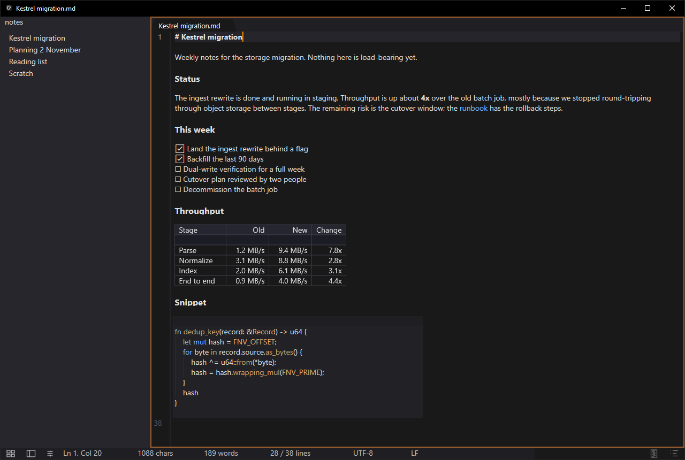
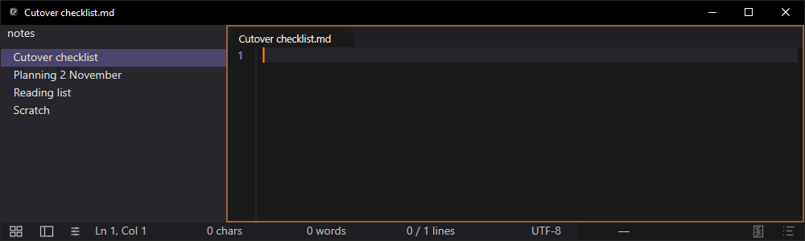
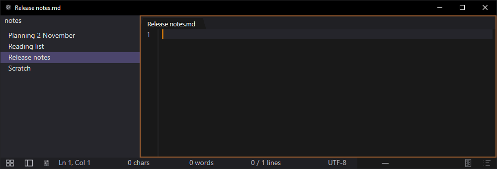

Every keystroke goes to a local SQLite database. The database is the document, and writing a file is an export.

Every notes app has the same defect and it isn't in the code. It's the moment where you've typed three paragraphs and some background thread in your head is still tracking whether you hit Ctrl+S.

That tracking is cheap once and expensive forever. It's a process you can't kill, running in service of a technical limitation from 1975 that we decided was a UI paradigm.

So I wrote an editor that doesn't need it. Continuity writes every keystroke to a local SQLite database. The database is the document. Writing a `.md` file is an export, the same way you'd export a PDF. Close the app without "saving" and you lose nothing, because the text was in the database the whole time.

I've used it as my daily notes app for months. Here's how it works and what it actually cost.



Line 1 there is showing its raw `# Kestrel migration` source because the caret is on it. Everything else stays rendered. I'll come back to how that works.

## The file is not the document

The standard model: a file on disk is the document, the editor holds a copy in memory, the copy diverges, and you periodically reconcile. Every bit of save-button UX falls out of that. Dirty indicators. "Do you want to save changes?" Autosave timers. Recovery dialogs that offer you a version from 14 minutes ago and ask you to guess which one you want.

All of that is scaffolding around one decision nobody revisits.

Continuity inverts it. The text in memory and the SQLite database are the document. Files are output. You can still save a note to a file with Ctrl+S, and a tab still shows when its file is behind, but neither of those is what keeps your work.

Which is the kind of claim that's worth demonstrating rather than asserting. Here the process is killed with `TerminateProcess` mid-sentence, no save, no prompt, no shutdown handler, and then relaunched:



The note, its content, the open tab and the caret position all come back, and typing carries on from the middle of the sentence. Nothing was recovered, because nothing was lost. The tab is still marked unsaved, because the note was never written to a file.

The write path, from a key going down to the bytes being durable, is six steps and no step in it waits on a user decision:

1. `WM_CHAR` arrives on the UI thread.
2. The text buffer takes one insert, delete, or replace op.
3. The buffer's revision advances.
4. An edit row with the op and its `checksum_after` is queued.
5. SQLite appends it to the write-ahead log, with `synchronous=NORMAL`.
6. It's durable and survives power loss.

Every edit becomes a row:

```sql
buffer_edits: (buffer_id, revision, op, bytes, checksum_after, undo_group)
```

`op` is insert, delete, or replace. That's the complete set. One atomic mutation type in the entire system, which matters enormously once you get to recovery.

A row per keystroke sounds absurd until you remember SQLite in WAL mode is *extremely* good at small appends, and you can batch within a frame anyway. The budget is 400 ms from accepted edit to durable on disk, at p99.

400 ms is the number I care about, and not because it's fast. Because it's *bounded*. The promise isn't that your keystroke hits the platter instantly. It's that the window where it hasn't is small and known, instead of being "whenever you remember."

## Replaying 40,000 edits is stupid, so don't

Append-only logs have the obvious problem: opening a buffer means replaying its whole history.

Snapshots. Continuity writes a zstd-compressed snapshot when any of three thresholds trips, whichever comes first: 500 edits since the last snapshot, 256 KiB of accumulated change, or 60 seconds elapsed.

The consequence is that replay depth is bounded at 500 edits regardless of how long a buffer has existed. A note with 40,000 edits of history replays at most 500 of them, not 40,000. That's arithmetic from the policy, not a measurement.

The part I'd defend hardest is the checksum. Every edit row carries `checksum_after`: FNV-1a of the buffer contents after that edit applies. On replay the editor recomputes and compares.

On a mismatch it stops at that revision. It doesn't skip the bad row or attempt a partial reconstruction. It halts at the last known-good revision and shows you a banner saying exactly where it stopped.

I went back and forth on this for a while, because "recover as much as possible" is obviously the friendlier option. It's also worse, and it's worse in a way that doesn't show up until much later. An app that hands you a quietly corrupted document is far more dangerous than one that says "I got you to revision 8,412 and something after that is wrong." The second one you can act on. The first one you discover six months later when you notice a paragraph you don't remember writing, and now you don't trust any of it.

So it fails loudly, at a known point, every time.

## A bug that cost me a day

Two FNV-1a implementations in the same codebase with different primes.

One lived in the persistence layer and was baked into every `checksum_after` value already written to disk. The other was a local copy I wrote later for content hashing, using the canonical prime, because obviously you'd just write the four-line function again rather than go look for the existing one.

Everything worked until they met. Save a file: hash computed with implementation A. Dirty check: compared against implementation B. Result: a file that saved successfully and immediately reported unsaved changes, forever.

The lesson isn't "be careful with hashes." It's that **a checksum baked into persisted data is a wire format the moment you ship it.** It stops being an implementation detail and becomes a contract with every database already out there. It needs to be one named function that nobody is permitted to reimplement, and that rule needs to be written down where the next person will hit it.

It's in the conventions doc now.

## Where the time goes

The entire premise is that this feels immediate, so I gate it in CI. These aren't targets on a dashboard someone glances at quarterly. They fail the build.

Everything a keystroke touches, upper bound at p99. Painting a frame and re-parsing the Markdown have tighter targets, 2 ms and 1 ms, but the tests run on shared hardware, so they fail at four times those: 8 ms and 4 ms.

| Gate | p99 budget |
|---|---:|
| keypress to pixel | 8 ms |
| WM_PAINT to frame ready | 8 ms |
| core apply edit | 4 ms |
| incremental Markdown parse | 4 ms |
| buffer apply edit | 2 ms |

Durability and loading sit two orders of magnitude away, so they're their own set. The two session-loading gates time the database side only, opening the store and loading the buffers, not the whole app starting:

| Gate | Budget |
|---|---:|
| load a 200-buffer session from the database | 500 ms |
| edit to durable on disk | 400 ms |
| open a 100 MB file | 300 ms |
| open the database for an empty session | 120 ms |
| find across 200 buffers | 80 ms |

Two of those have a current measured value, from a release build on 2026-08-26. Everything else above is a budget, not a measurement.

| Gate | Measured | Budget |
|---|---:|---:|
| keypress to pixel | 3.4 ms | 8 ms |
| stripped binary | 8.55 MiB | 9 MiB |

Zero heap allocations per keystroke is a rule for the typing path too, but it's checked in code review, not by a test.

## What it's built on, and what it isn't

Native Win32. DirectWrite and Direct2D. ropey for the buffer, tree-sitter for Markdown, SQLite for storage.

No Electron. I don't need 200 MB and a browser engine to render text I typed. That's not a performance argument, or not only one. It's that I want a tool I can understand and repair, and "it's a Chromium" is the opposite of that.

No `async fn` anywhere in the workspace. Threads and `crossbeam_channel`, and a rule that every piece of mutable state names its owning thread in a doc comment. One writer of buffer state. One owner of the window handle. "Which thread owns this" is answerable by reading one line, and I've spent enough of my life on the version of that question you cannot answer.

It's about 217,000 lines of Rust across 26 crates, counted from source.

The constraint I'd push on anyone building something similar: the text is the source of truth, and the rendering only shows it. Markdown rendering goes through a layer that can hide, replace, or wrap parts of the source. It cannot add content. Every WYSIWYG feature has to survive that layer being ripped out, or it's the wrong feature.

In practice that looks like this. Each line renders as it's completed, and the line under the caret shows its source:



There's no preview pane and no mode switch, because there's nothing to preview. The text on screen is a projection of the bytes in the file, computed per line.

That rule killed several things I wanted. It also means what you see is always what's in the file, which is the whole reason to use a plain-text notes app instead of a rich-text one that lies to you about what it's storing.

It's Windows only. The engine is portable Rust and there's a WASM build, but the app is Win32 and staying Win32. It's not a code editor either. It highlights fenced blocks and it's fine for code notes, but if you want an IDE, several excellent ones exist. And it's 0.4.8, so I break things.

## Try it

```
winget install Continuity.Continuity
```

Or take the MSI, a portable zip, or a single standalone exe. Portable keeps everything beside the executable including the database, so it runs off a USB stick without touching AppData or the registry.

There's no account and no cloud, and no sync service that gets acquired and shut down in three years. It does check GitHub Releases for updates.

[github.com/jatoran/continuity](https://github.com/jatoran/continuity), MIT.

The editing engine is published separately if you want it inside something you're building. That's a separate post.

---

Budgets read from the perf-gate tests in `crates/*/tests/perf_gates.rs` and `xtask/src/artifact_budget.rs`. Measured values from `cargo xtask bench-fast`, release build. Inventory from `cargo xtask docs`.
