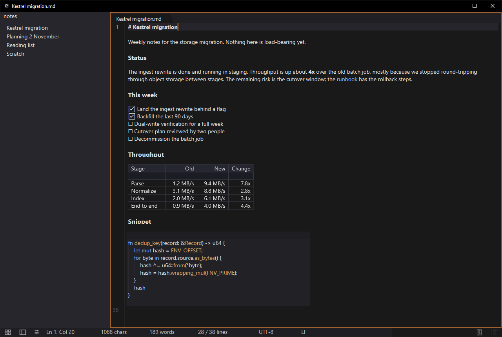
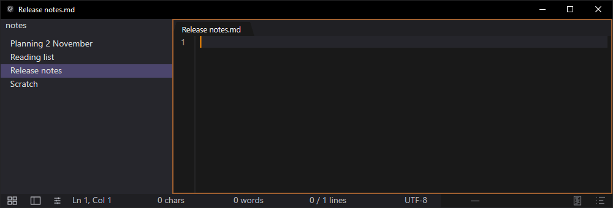
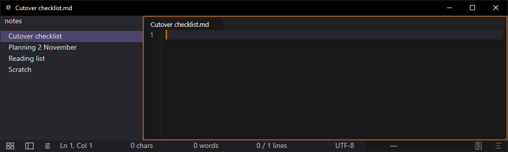
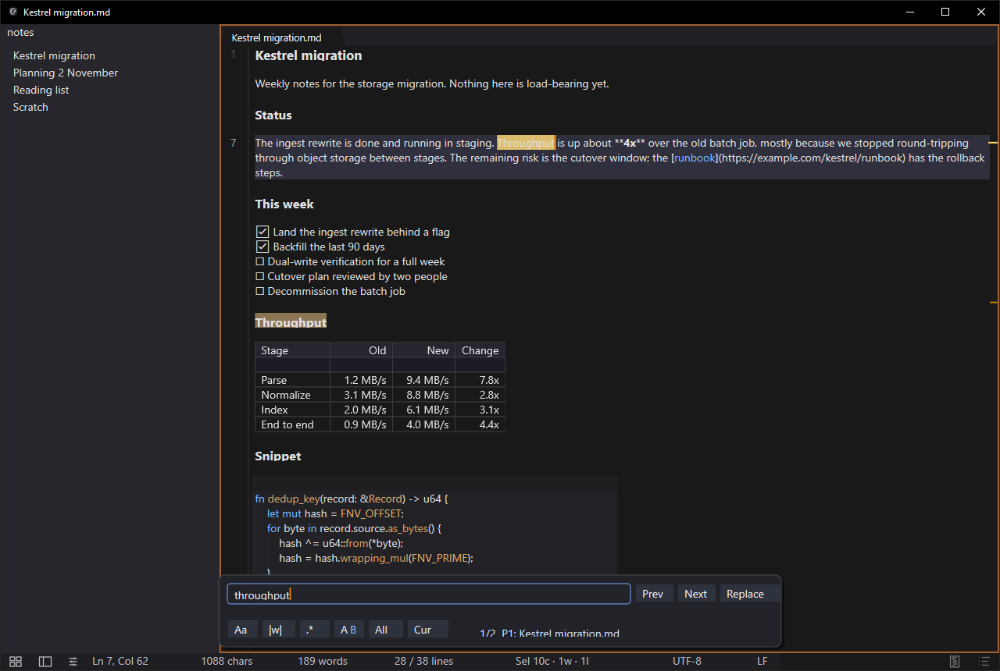

## Overview

Continuity is two things in one repository.

The first is a native Win32 Markdown notes editor. Every keystroke writes to a local SQLite database, so the database is the document and writing a `.md` file is an export rather than a commitment. You can still save a note to a `.md` file whenever you want one, and a tab shows when its file is behind, but saving is not what keeps the work safe: a crash or a force-close loses nothing.

The second is the editing engine underneath it, extracted into a Rust crate that knows nothing about where the text is stored. The same engine runs in four places off one codebase: the native app, a browser Web Component compiled to WASM, a Python module, and a C ABI.

## Screenshots

Line 1 shows its raw `# Kestrel migration` source under the caret while everything else stays rendered, which is the display-map rule in a single frame.



Markdown renders as each line is completed. No preview pane, no mode switch.



The process is killed with `TerminateProcess` mid-sentence and relaunched. The note, the open tab and the caret position all come back, and typing picks up where the sentence stopped, because the text was in the database the whole time. The tab is still marked unsaved, because the note was never written to a file.



Find across the note, with regex, case, word, and scope toggles and a match counter.



## Problem

Two problems, one per half.

The notes editor exists because Sublime Text has the speed, ephemerality, and crash-safety I want and doesn't do Markdown, while Obsidian does Markdown and also wants to be a knowledge graph with a plugin ecosystem and a startup time. Neither one is the thing.

The engine exists because the valuable part of the editor, the text handling and selections and undo and Markdown projection, was welded to an application that only runs on Windows. None of that logic is Windows-specific and all of it was trapped.

## Approach

### The storage decision came before the UI

The database is the document. Every edit becomes a row in `buffer_edits` carrying the op, the resulting checksum, and an undo group. The enforced budget is 400 ms from accepted edit to durable on disk at p99. Deciding this on day one meant saving to a file never had to be the thing that keeps work safe.

### The text is the source, the rendering only shows it

Markdown rendering goes through a layer that can hide, replace, or wrap parts of the source text. It cannot add content. Every WYSIWYG feature has to survive that layer being ripped out, or it doesn't ship.

### The engine owns nothing but editing

Making the core embeddable meant taking storage out of it first. It owns buffers, selections, edit planning, undo, and revisions, and it owns nothing else. No SQLite, no filesystem, no threads, no window. The desktop app didn't lose durability, it stopped being the thing that has durability and became the thing that writes the engine's output into SQLite.

### Stack

- Rust across 26 crates, with no `async fn` anywhere in the workspace
- Win32, DirectWrite and Direct2D for the native surface
- ropey for the buffer, tree-sitter for Markdown parsing
- SQLite in WAL mode for per-keystroke durability
- WASM for the browser Web Component, with a thin JavaScript adapter layer

## Outcomes

Performance limits are tests that fail the build rather than numbers on a dashboard: 8 ms from key press to screen and 400 ms for typed text to reach the database, both at p99, and a 9 MiB cap on the stripped exe. Keypress to pixel measured 3.4 ms on a release build in August 2026, and the stripped binary was 8.55 MiB.

One shared set of behavior tests runs against every binding: same inputs, same resulting text, same selections, same revisions, same deltas. When the Python binding and the browser disagree about a block toggle, that's a failing test rather than a support ticket eighteen months later.

## Installing it

```
winget install Continuity.Continuity     # Windows desktop
cargo add continuity-engine              # Rust, crates.io
npm i @continuity-editor/editor          # Browser and Electron
```

MSI, portable zip, and standalone exe ship in each GitHub release, as do the Python wheel and the C DLL plus header. PyPI is deliberately empty until there are cross-platform wheels worth publishing.

## Limits

The desktop app is Windows-only and will stay Windows-only. The engine is portable, the app is not. It's not a code editor: fenced blocks highlight and it's fine for code notes, but it isn't an IDE. It's early, currently 0.4.13, and things break. Builds are unsigned, so installs show a SmartScreen warning until code signing is in place. There is no hosted browser demo yet.

MIT licensed.
