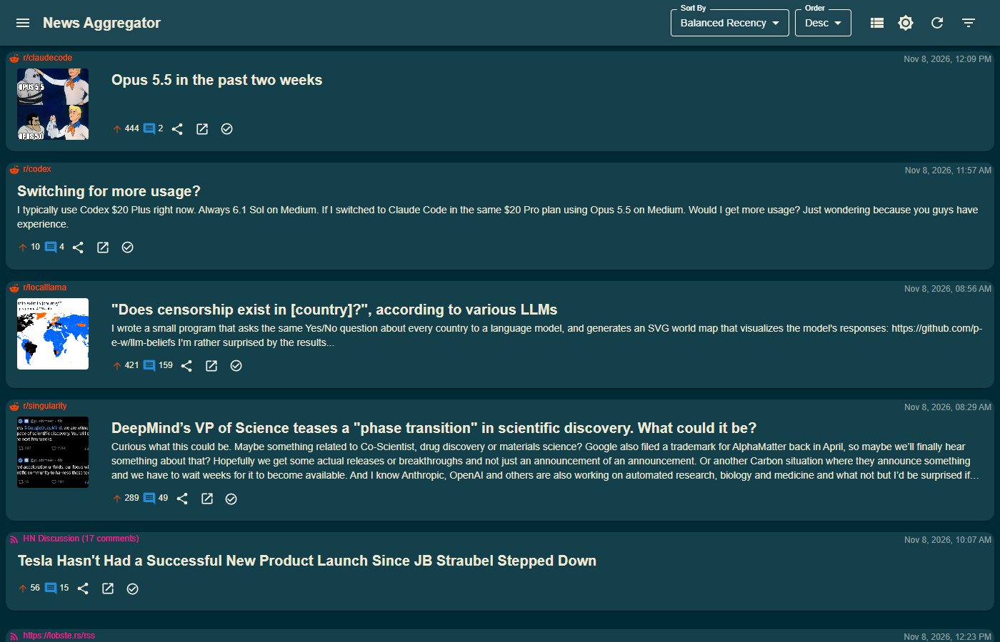
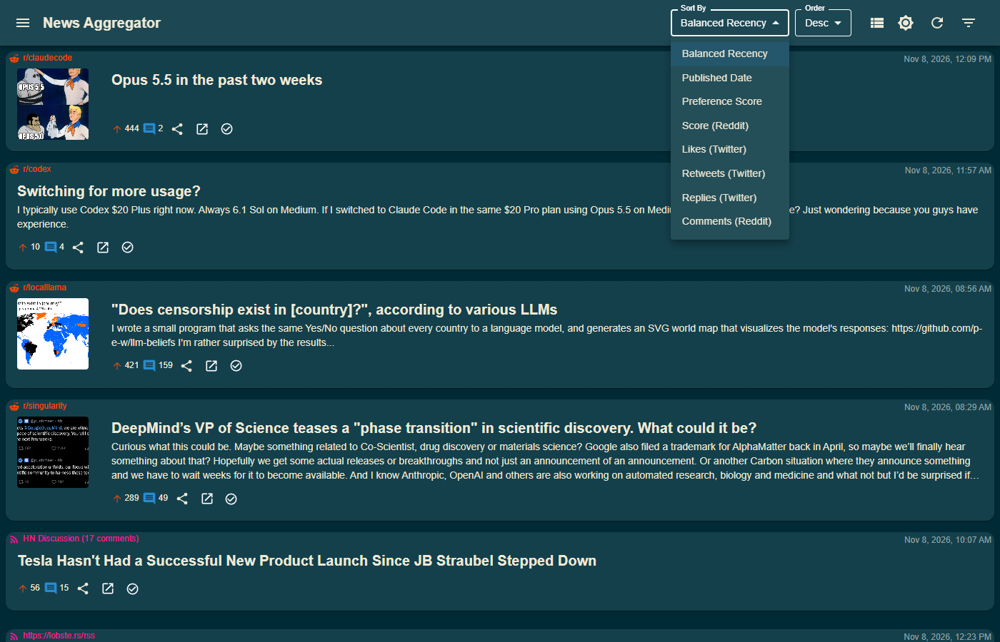

## Overview

News Aggregator pulls Reddit, RSS and a few other kinds of source into one feed that I read instead of the sites themselves.
It runs on my home server as a Docker Compose stack: six Python services, an nginx front end and Postgres 16.
On 8 November 2026 it was following 225 sources and holding 56,233 items from the last 30 days, 9,517 from Reddit and 46,716 from RSS, so about 1,900 new items a day.

The code is private.
This page describes it; there is no repository to link.

## Screenshots

The feed in Balanced Recency order, with Reddit posts and RSS items interleaved.

The other orderings sit beside it: publish date, preference score, and the raw Reddit and Twitter engagement numbers.

## Problem

I wanted my own news feed, so I'm not controlled by other platforms' algorithms.

My notes from the start of the project, December 2024, list what it was for: de-sensationalize news by reading the content and writing alternative, unbiased titles and descriptions; cull the nonsense; remove items I don't want to see; combine duplicates and prefer the original source; and prioritize what I do want through preference rules.
The line that sums it up: "really want to be able to filter out nonsense from various feeds."

Merging sources brings its own problem: the busiest one takes over the top of the feed.
The early versions of this one were mostly fresh Reddit posts with a score of 1.

## Approach

### Ingestion

- Reddit goes through my Search Gateway, so this app holds no Reddit credentials. Listings default to hot, 25 posts a subreddit, one subreddit at a time.
- RSS and Atom are parsed directly, and article bodies are extracted through the gateway. Hacker News items get their comments from the Algolia API.
- Twitter/X profiles and arbitrary web pages also go through the gateway, but neither is producing items right now (see Limits).
- A scheduler service owns the cadence: Reddit and Twitter every 30 minutes, RSS hourly, custom web sources every 70 minutes, with per-source overrides. An hourly job settles each Reddit post's score once it is about 36 hours old. Items older than 30 days are deleted nightly.

### Ranking

The default order, Balanced Recency, is a weighted fair queue across sources.
Each item gets a base score from recency (an 18-hour half-life) plus its engagement relative to the median of its own subreddit or account, so a small subreddit's good post can compete with a big subreddit's average one.
On top of that, every source has a target share of the feed, set in two levels: by type first (RSS 40%, Reddit 35%, Twitter 25%), then split among that type's sources by a per-source weight.
A source that falls behind its share gets a bounded catch-up bonus, so it surfaces without flooding the top of the page.

The version before this one buried slow sources completely.
The first tweet sat at position 62 and five followed accounts were nowhere in the top 200, because a recency handicap cost a nine-hour-old tweet more than any engagement could earn back, and the only anti-dominance rule never fired.
With fair share, all 19 sources in the test pool appear by about position 67 and the first tweet lands at 8.
The median age of the top 30 moved from 8.5 hours to 8.6.

### The LLM layer

For each item the enrichment service asks a model, through OpenRouter, for a neutral title with the emotional language and hyperbole removed, a short factual summary, key concepts, facts, tone, keywords, categories, and a flag for promotional SEO filler.
It runs only for sources that opt in, only on items with at least 200 characters of content, and only on Reddit posts that have earned some engagement first.

### Preference rules

Rules can boost or bury items by category, keyword, title, source type, concept, sentiment or content, scoped to everything, one feed or one source.
They feed a preference score, which is also one of the sort orders.

### Stack

- FastAPI for every service, Postgres 16 with JSONB for per-source metadata, APScheduler for the refresh jobs
- React 18, TypeScript and Material UI, with grid, compact, list, detailed and gallery views, read and read-later state, and swipe-to-read on a phone
- Docker Compose on my home server, deployed from my PC

## Outcomes

Much of the recent work has been upkeep on a stack that runs around the clock.

- Reddit comment metrics were being inserted on every refresh instead of updated: 3.98 million metric rows for 2,800 comments. Fixing that took the database from 1.5 GB to 120 MB.
- The periodic score recalculation went from 254 seconds and 1.6 GB of memory to about 7 seconds and 130 MB, and the stats refresh from 5.5 seconds and 720 MB of growth to 0.7 seconds and 9 MB.
- The recommended feed query dropped from about 800 ms to 50-80 ms.
- Twitter provider failures used to look like empty timelines, and failed scrapes returned success. Both now report as failures.

## Limits

- The LLM layer is switched off. Enrichment is off by default for new sources, and none of the 56,233 items in the current 30-day window has a rewritten headline, so the de-sensationalizing described above is built but not running.
- Twitter/X is not producing anything. Its sources show no items in the current window; it depends on a nitter provider that keeps breaking.
- RSS descriptions sometimes show raw HTML in the card views.
- About 54% of recent Reddit posts trip the low-engagement penalty, so Reddit fills about 29% of the feed against its 35% target.
- It is single-user, with no authentication, and only reachable on my own network.
- Two goals from the original notes were never built: fact-checking, and a user prompt that sets the rewriting style.
